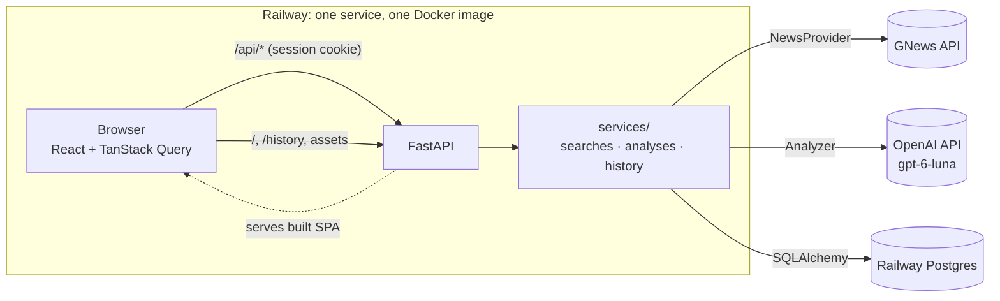

# News Analyser

Search recent news on any topic, get an **AI summary and sentiment** for the articles you care about, and track how coverage leans over time.

- **Live app:** https://news-analyser-production-c2428787.up.railway.app/ (the password is in the handover email)
- **Walkthrough video:** _link to be added_
- **How the code fits together:** [`NOTES.md`](NOTES.md)

## What it does

Built for a busy reader keeping tabs on a topic, such as a company, a sector or a story, who wants the gist and the tone of coverage quickly.

1. **Search** recent news by keyword, sorted by relevance or date, optionally within the past 24 hours, week or month. Results are stored, so refreshing or sharing a link reopens the same results without spending API quota.
2. **Analyze** any article with one click, or tick several (up to 10) and analyze them together in the background, with progress shown per article. The AI returns a one-sentence TL;DR, key points, a sentiment (positive / neutral / negative) with a score from −1 to 1, the reason for that sentiment, and up to two **quotes from the article** as evidence.
3. **Everything is stored** in Postgres: searches, articles and analyses.
4. **History** shows every analyzed article with filters (sentiment, source, search, date) and a summary strip: counts per sentiment and the average score for whatever is filtered.

## Architecture



- **One service:** FastAPI serves both the JSON API and the built React app, on the same origin. That means no CORS, one deploy, and one URL.
- **Thin routes, logic in services:** `routers/` validate input and shape responses. `services/` hold the logic: caching, quota, analysis and filtering.
- **External APIs sit behind interfaces** (`NewsProvider`, `Analyzer`), each with an offline **fake** implementation. Local development, CI and the end-to-end flows run without spending news quota or OpenAI tokens, and swapping a provider means writing one new class.

**Data model:** `searches` (one row per real news-API call) → `search_results` → `articles` (unique by URL) → `analyses` (at most one per article).

## Key decisions and tradeoffs

| Decision | Why | Tradeoff |
|---|---|---|
| **FastAPI + React (Vite) + Postgres** | Explicit REST API with typed schemas and generated OpenAPI docs (`/docs`). Matches a Python/React stack. | Two toolchains (uv and npm), smoothed over by a `Makefile`. |
| **GNews**, after rejecting FreeNewsAPI | FreeNewsAPI advertised real-time articles and full text, but a live probe showed its keyword search had been **removed** and its title search returned 500. GNews search works. | The free plan is ~12 h behind and gives ~250 characters per article. The UI says so, and analyses note that they're based on the article's opening. |
| **Stored searches + a 30-min cache + a daily quota guard** | A repeated search reuses stored results (no API call). Today's real calls are counted, and new ones are refused at 95/100. URLs hold `?search=id`, so refreshes and shared links are free. | Results can be up to 30 min older than a fresh call. |
| **One Structured Outputs call per article** | The SDK returns a validated pydantic object, so there's no JSON parsing. The prompt is versioned and stored with each analysis, along with the model and token usage. | One prompt does both summary and sentiment, which is cheaper and consistent, but they can't be tuned separately. |
| **The model's output is checked, not trusted** | The score is clamped and the lists are capped. Evidence quotes are kept **only if they appear verbatim in the article**. Postgres CHECK constraints back this up. A refusal or invalid output returns an honest 502; there's never a fabricated result. | Some real quotes get dropped if the model paraphrases them. |
| **No LLM "confidence" score** | Self-reported confidence isn't calibrated and overlaps with the score. Evidence quotes make the sentiment checkable instead. | Less of a single "how sure" number to show. |
| **Forgiving search** (only when a search finds nothing) | Retry once with a typo-corrected query, then once with "match any word" (at most 3 GNews calls, all counted against the quota and spaced out for GNews's 1 request/second limit). Typos are fixed by a free local spell-checker when it's confident, and by gpt-6-luna otherwise (it knows names: "nvdia" → "nvidia", not "nadia"). The banner says what ran, with "Search instead for…". Stored articles are also fuzzy-matched in Postgres (`pg_trgm`) at no quota cost. | A typo'd search can use up to 3 of the 95 daily requests. Searches that already return results are never second-guessed. |
| **Batch analysis as a server job + polling** | `POST /api/analysis-batches` returns **202 Accepted** with a `Location` to poll. Three worker threads run the analyses, each through the same per-article row lock, so a batch and a single "Analyze" click never pay twice for one article. Cards fill in as each analysis lands. Batches are capped at 10 to bound one request's AI spend. | The job runs in-process (FastAPI `BackgroundTasks`), so a restart mid-batch loses it. Leftover items are reported as `interrupted` after 10 minutes instead of hanging. A real queue (RQ or Celery with Redis) would add retries and survive restarts. |
| **Each article analyzed once** | Asking again returns the stored analysis (200) without calling the AI. | Re-running (e.g. after a prompt change) isn't in the UI yet. |
| **Password sign-in page**, not HTTP basic auth | Basic auth's browser pop-up doesn't appear in embedded browsers or link previews. Visitors saw raw JSON. A form plus an HMAC-signed, HttpOnly cookie works everywhere, with no server-side session store. | One shared password, with no per-user accounts or audit trail. |
| **Migrations run at container start**, not as a Railway pre-deploy step | Railway's private network (where Postgres lives) is only guaranteed at runtime. A failed migration still stops the server starting, so the health check keeps the old deploy serving. | With several replicas, each would try to migrate at startup. That would need a migration job or an advisory lock to scale. |
| **Sync SQLAlchemy, integer IDs, limit/offset pagination, no `/v1`** | The simplest options that fit a single-user app with hundreds of rows and one client deployed together with the API. | Each would change at scale (async I/O, opaque IDs, cursor pagination, versioning). The reasons are noted so the change is deliberate. |

## What went wrong, and how it was handled

Each item below has its own PR or commit, with a test where the bug could be reproduced.

- **Concurrency bugs found in code review.** Two requests near the daily limit could both pass the quota check, and two clicks on one article could pay for two AI calls. Both were reproduced with **real two-thread tests** against committed transactions, then fixed: a per-provider Postgres advisory lock for the quota, and a row lock (`SELECT … FOR UPDATE`) per article.
- **Untrusted provider data.** An automated security review flagged that article URLs went straight into `href`. Non-`http(s)` URLs are now dropped where provider data enters the system, so every provider and page is covered.
- **Deploying to Railway:** its builder rejects Docker `--mount` flags (two fixes, #4 and #5), and its pre-deploy step couldn't reach the private database (#8). Each was diagnosed from the build or deploy logs, not guessed.
- **Basic auth looked broken** in browsers that don't show its pop-up. Replaced with a sign-in page (#6).
- **Config mistakes fail loudly.** An uppercase `ANALYZER=OPENAI` crashed the new container on startup, and the health check kept the previous version serving, so users never saw a broken app.

## How it was built

- **One PR per feature**, each with a description (what / why / how verified / what wasn't verified), small focused commits, and merges that keep the history readable.
- **`main` is protected:** merging requires green CI (backend, frontend and a production Docker build) and resolved review threads.
- **CI** runs ruff, pyright, pytest against a real Postgres, oxlint, tsc, the Docker build, and `alembic check` (which fails if models and migrations drift apart).
- **Tests:** 119 backend tests against real Postgres. Almost all run inside a transaction that's rolled back afterwards. The exception is the real-concurrency tests for the race conditions, which need genuinely committed transactions and truncate their tables when they finish. Bug fixes start with a failing test.
- **Pull requests get an automated AI code review (Codex).** Each finding was fixed (test-first where it was a bug), answered in its thread, and resolved before merging.

## Limitations and what I'd do with more time

- **Full article text:** a paid news plan, or a provider with a details endpoint, would let analyses read the whole article. `text_source` is already stored for that.
- **Re-run and delete an analysis** (e.g. after a prompt change). Also: per-topic sentiment over time, and streaming the analysis as it's generated.
- **A durable job queue** (RQ or Celery) for batch analysis, with retries for failed items and jobs that survive a restart.
- **Top headlines** as the empty state of the search page.
- **An end-to-end browser test** (Playwright, using the fake providers) of search → analyze → history in CI. Today the UI is checked by hand in a browser for each PR.
- **Frontend unit tests:** the frontend has lint and type checks, but no unit tests yet.
- **A version or commit hash in `/api/health`**, to confirm which build is live without looking at bundle hashes.
- **Per-user accounts** instead of one shared password, if more than a handful of people used it.

## Run it locally

Prerequisites: `uv`, Node 22.22+ (React Router 8 requires it), Docker (for Postgres).

```bash
make install
cp backend/.env.example backend/.env
make dev     # starts Postgres (port 5433), applies migrations, runs backend + frontend
```

- App: http://localhost:5173 (Vite forwards `/api` requests to the backend)
- API docs: http://localhost:8000/docs

By default the backend uses `NEWS_PROVIDER=fake`, which replays a saved GNews response, so local development spends none of the API quota. For live news, set `NEWS_PROVIDER=gnews` and `GNEWS_API_KEY` in `backend/.env`.

## Database

- `make db` starts Postgres in Docker on port **5433**, so it doesn't clash with a local install on 5432. It creates two databases: `news_analyser` for dev and `news_analyser_test` for tests.
- `make migrate` applies migrations. `make migration name="..."` generates one from model changes.
- Tests migrate the test database to the latest version at the start of each run, which also checks that every migration applies cleanly.
- **Tests need a disposable database.** The concurrency tests commit data and then `TRUNCATE searches, articles, search_results CASCADE`, so never point `TEST_DATABASE_URL` at a database whose data you want to keep. The default, `news_analyser_test` from `make db`, exists only for this.
- In production, the container runs `alembic upgrade head` before starting the server. If a migration fails, the server never starts, the health check fails, and Railway keeps the previous deploy serving. This isn't a Railway pre-deploy command because Railway's private network (where Postgres lives) is only guaranteed at runtime.

## Checks

```bash
make check   # lint + typecheck + tests
```

CI (GitHub Actions) runs the same checks on every pull request, plus a production Docker build. It uses the fake news provider, so it needs no secrets and spends no API quota.

## Deployment

One Docker image (see [`Dockerfile`](Dockerfile)) runs the whole app. A Node stage builds the React frontend, and FastAPI serves it alongside `/api` on a single origin, so there's no CORS. The app is deployed on Railway, which builds the root `Dockerfile` on every push to `main`.

Run the production image locally:

```bash
docker build -t news-analyser .
docker run -p 8000:8000 -e NEWS_PROVIDER=fake news-analyser   # http://localhost:8000
```

Production environment variables (set in Railway, never committed):

| Variable | Purpose |
|---|---|
| `NEWS_PROVIDER=gnews`, `GNEWS_API_KEY` | Live news |
| `APP_PASSWORD`, `SESSION_SECRET` | Puts the app behind a sign-in page (one shared password) so strangers can't spend the API quotas. `SESSION_SECRET` signs the session cookie. `/api/health` stays open for Railway's health check. |
| `DATABASE_URL` | Railway Postgres connection string (a reference variable). `postgresql://` URLs are converted to the psycopg driver automatically. |
| `NEWS_MIN_REQUEST_INTERVAL` | Seconds between a search's fallback calls (default 1.1; GNews free allows 1 request/second) |
| `NEWS_DAILY_REQUEST_LIMIT` | New searches allowed per UTC day (default 95; GNews free is 100) |
| `ANALYZER=openai`, `OPENAI_API_KEY`, `OPENAI_MODEL` | AI analysis (model defaults to `gpt-6-luna`). Locally `ANALYZER=fake` analyzes offline without spending tokens. |
| `PORT` | Injected by Railway; defaults to 8000 |

## API

Interactive docs: `/docs` (OpenAPI). Main endpoints:

| Method & path | Purpose |
|---|---|
| `POST /api/searches` `{q, sort, period, exact}` | Run a search. **201** = new; **200** = an identical search from the last 30 min was reused, so no news-API call was made. **429** once the daily quota is used. With no results (and `exact: false`) it retries with a corrected query, then "any word"; `original_query` and `match_mode` in the response say what happened. |
| `GET /api/searches?limit&offset` | Search history, newest first (with `total`). |
| `GET /api/searches/{id}` | A stored search with its articles. Never calls the news API. |
| `GET /api/articles/similar?q=&limit=` | Stored articles whose titles fuzzily match `q` (Postgres `pg_trgm`). Never calls the news API. |
| `GET /api/quota` | News-API requests used and left today (resets 00:00 UTC). |
| `GET /api/articles?analyzed&sentiment&source&search_id&published_from&published_to&sort&limit&offset` | Stored articles with their analyses, filtered and sorted (with `total`). |
| `GET /api/stats?<same filters>` | Counts per sentiment, average score, and the sources list. Uses the **same** filter code as `/api/articles`, so the numbers always match the list. |
| `GET /api/articles/{id}` | An article with its analysis (`null` until analyzed). |
| `POST /api/articles/{id}/analysis` | AI summary + sentiment. **201** = new; **200** = already analyzed, so the AI isn't called again. **502** if the AI fails (nothing stored). |
| `POST /api/analysis-batches` `{article_ids}` | Analyze 1–10 articles in the background. **202** with a `Location` header to poll; already-analyzed articles are `skipped`. **404** if any id doesn't exist (listed in `details.missing_ids`; nothing stored), **422** for an empty, too long or repeated list. |
| `GET /api/analysis-batches/{id}` | Batch progress: `status` (`running`/`done`), `counts`, and per article `status` (`pending`/`running`/`done`/`skipped`/`failed`), `error_code` and the finished `analysis`. |
| `POST /api/auth/login`, `POST /api/auth/logout`, `GET /api/auth/session` | Sign-in. |
| `GET /api/health` | App and database health. |

### Conventions

Every error response uses one shape:

```json
{ "error": { "code": "validation_error", "message": "Request validation failed", "details": [...] } }
```
